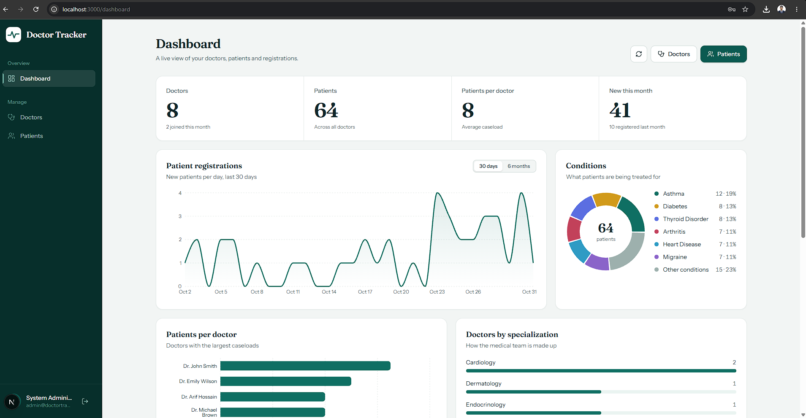
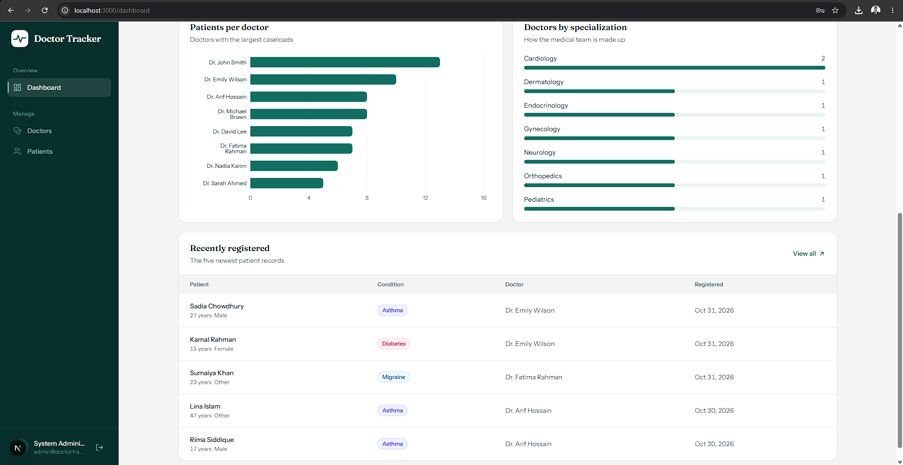
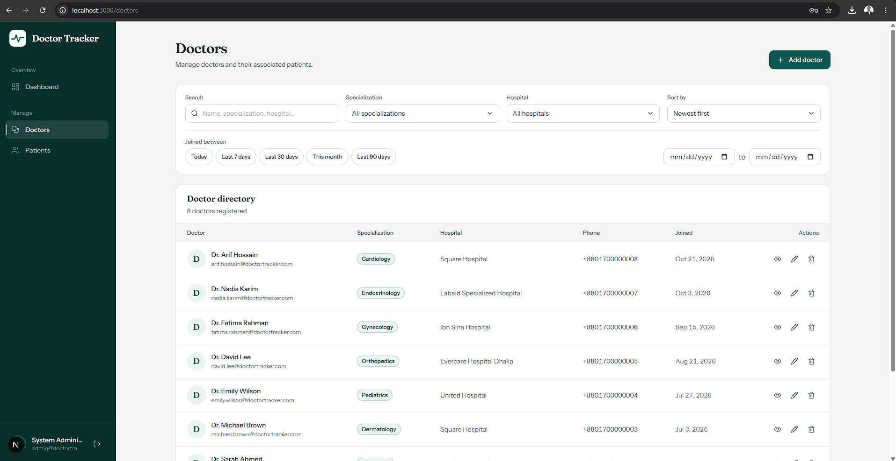
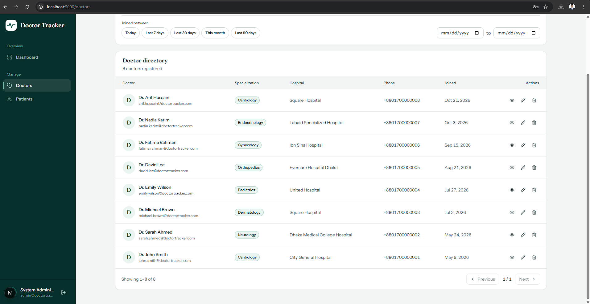
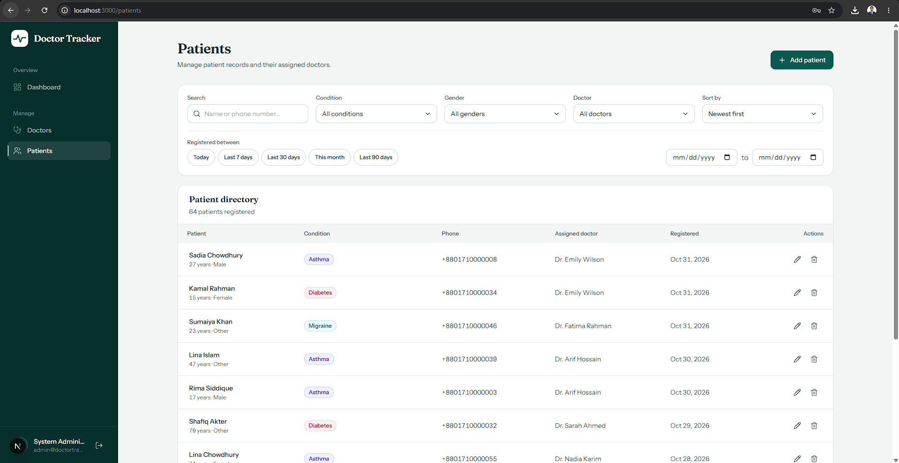
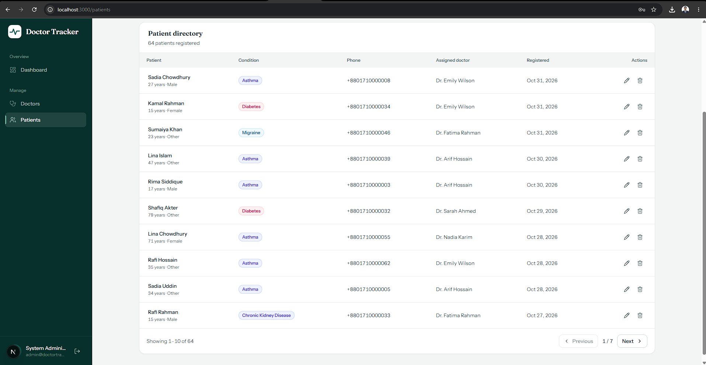
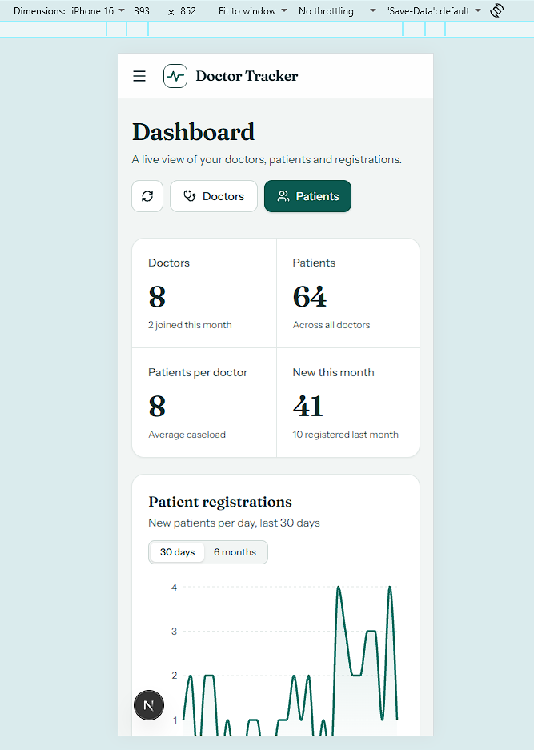
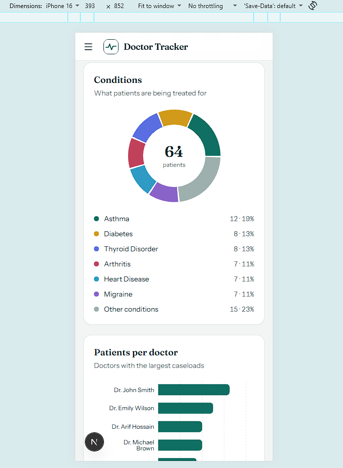
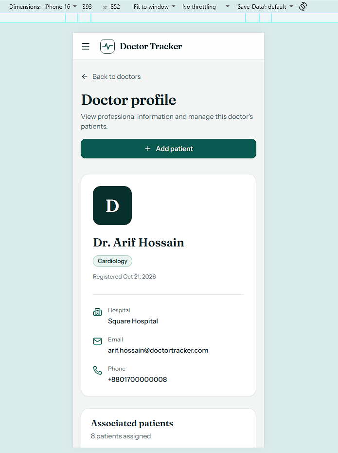
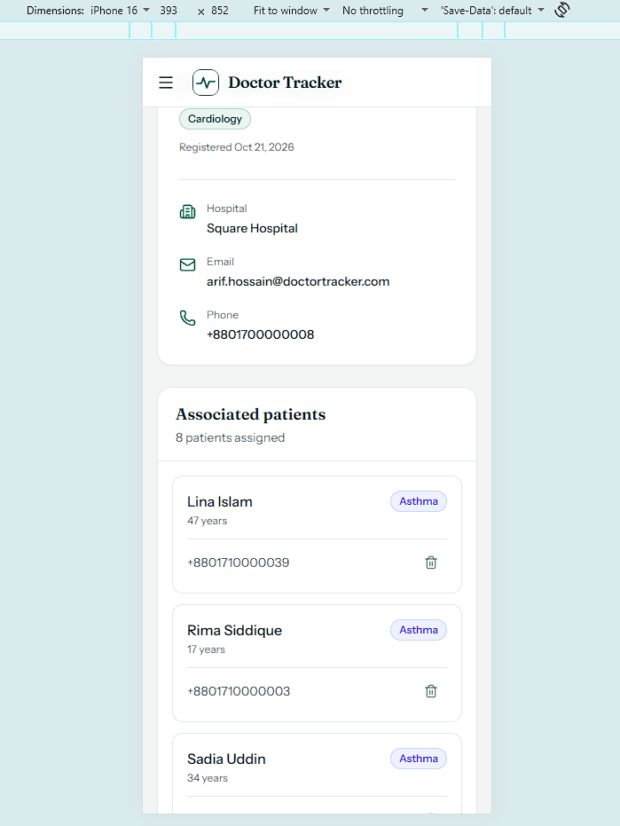

# Doctor Tracker

A secure, full-stack clinic administration application for managing
doctor profiles, patient records, and operational insights through a
centralized dashboard.

Doctor Tracker provides authenticated administrative access, searchable
directories, dynamic filters, paginated records, doctor-specific patient
management, and dashboard analytics.

## Demo Access

You can use the following credentials to explore the application:

| Field | Value |
|---|---|
| Application URL | https://your-frontend-url.com |
| Email | admin@doctortracker.com |
| Password | admin123 |

**Note:** These credentials are provided for demonstration and
evaluation purposes only. The application uses fictional demonstration
data.

## Features

### Authentication & Security

-   Secure administrator login and logout.
-   JWT authentication using HTTP-only cookies.
-   Protected frontend routes and backend API endpoints.
-   Login rate limiting (10 failed attempts per 15 minutes).
-   Request validation using Zod.

### Doctor Management

-   Create, view, update, and delete doctor profiles.
-   Search doctors by name, specialization, hospital, and email.
-   Filter by specialization, hospital, and joining date.
-   Sorting and server-side pagination.
-   Dedicated doctor profile pages.

### Patient Management

-   Create, view, update, and delete patient records.
-   Add patients directly from a doctor's profile.
-   Search patients by name or phone number.
-   Filter by condition, gender, doctor, and registration date.
-   Sorting and server-side pagination.

### Dynamic Filtering & Search

-   Filter options are generated dynamically from database values.
-   New specializations, hospitals, and medical conditions automatically
    appear in filter dropdowns.
-   Case-insensitive label normalization prevents duplicate filter
    values.
-   Word-prefix search supports matching multiple words in any order.

### Dashboard & Analytics

-   Total doctors and patients.
-   Average patient caseload per doctor.
-   Patient registration trends (30 days and 6 months).
-   Patient distribution by medical condition.
-   Patients per doctor.
-   Doctors by specialization.
-   Recently registered patients.

### User Experience

-   Responsive desktop and mobile layouts.
-   Shared loading, empty, and error states.
-   Confirmation dialogs and notifications.
-   Accessible navigation and dialogs.
-   Date filters with predefined ranges and custom date selection.

## Tech Stack

  Category         Technologies
  ---------------- -----------------------------------------
  Frontend         Next.js App Router, React, TypeScript
  Styling          Tailwind CSS v4
  Server State     TanStack Query
  Charts           Recharts
  Typography       Fraunces, Instrument Sans (`next/font`)
  Backend          Node.js, Express.js, TypeScript
  Database         MongoDB, Mongoose
  Validation       Zod
  Authentication   JWT, HTTP-only cookies
  API              RESTful JSON API

## Architecture

Doctor Tracker follows a decoupled architecture with two independently
running services:

-   **Frontend:** Next.js application located in `/frontend`.
-   **Backend:** Standalone Express REST API located in `/backend`.
-   **Database:** MongoDB for persistent data storage.

### System Overview

``` text
Browser
   |
   v
Next.js Frontend
   |
   |-- App Router & Protected Routes
   |-- React Components & Forms
   |-- TanStack Query
   |-- API Client (Credentials Included)
   |
   | HTTP (Local) / HTTPS (Production)
   v
Express REST API
   |
   |-- Authentication Middleware
   |-- Zod Request Validation
   |-- Controllers & Services
   |-- Mongoose Models & Queries
   |
   v
MongoDB
```

### Authentication Flow

1.  The administrator submits login credentials through the Next.js
    application.
2.  The frontend sends the authentication request to the Express API.
3.  The API verifies the administrator's password hash.
4.  A signed JWT is issued through an HTTP-only cookie.
5.  Subsequent API requests automatically include the authentication
    cookie.
6.  Authentication middleware verifies the token before allowing access
    to protected endpoints.
7.  TanStack Query manages API caching and synchronizes server state
    after successful mutations.

## Local Setup

### Prerequisites

-   Node.js 20 or later
-   npm
-   MongoDB instance or MongoDB Atlas connection string

### 1. Backend Setup

Navigate to the backend directory:

``` bash
cd backend
npm install
```

Create your environment file.

**macOS / Linux**

``` bash
cp .env.example .env
```

**Windows PowerShell**

``` powershell
Copy-Item .env.example .env
```

Configure `backend/.env`:

``` env
NODE_ENV=development
PORT=5000
MONGODB_URI=mongodb://127.0.0.1:27017/doctor-tracker
JWT_SECRET=your-random-secret-at-least-32-characters
JWT_EXPIRES_IN=1d
FRONTEND_URL=http://localhost:3000
ADMIN_PASSWORD=your-strong-admin-password
TRUST_PROXY_HOPS=1
```

Seed the administrator account and sample doctors:

``` bash
npm run seed
```

Optionally, populate fictional demo patients:

``` bash
npm run seed:demo
```

The demo seed creates 64 fictional patient records distributed across
approximately six months. It is idempotent and refuses to run in
production.

Start the backend:

``` bash
npm run dev
```

Backend health check:

`http://localhost:5000/api/health`

### 2. Frontend Setup

Open another terminal:

``` bash
cd frontend
npm install
```

Create the frontend environment file.

**macOS / Linux**

``` bash
cp .env.example .env
```

**Windows PowerShell**

``` powershell
Copy-Item .env.example .env
```

Configure `frontend/.env`:

``` env
API_URL=http://localhost:5000
```

Start the frontend:

``` bash
npm run dev
```

Open the application at `http://localhost:3000`.

### Default Administrator Account

The seed script creates the administrator account using:

-   **Email:** `admin@doctortracker.com`
-   **Password:** The value configured in `backend/.env` as
    `ADMIN_PASSWORD`.

Use a strong password and do not publish real administrator credentials.

## API Documentation

All endpoints are prefixed with `/api`.

Protected endpoints require a valid authentication cookie.

### Authentication

  Method   Endpoint         Description
  -------- ---------------- ----------------------------
  POST     `/auth/login`    Authenticate administrator
  POST     `/auth/logout`   Sign out administrator
  GET      `/auth/me`       Get current administrator

### Dashboard

  Method   Endpoint             Description
  -------- -------------------- ------------------------------------------
  GET      `/dashboard/stats`   Retrieve dashboard metrics and analytics

### Doctors

  ---------------------------------------------------------------------------
  Method                  Endpoint                    Description
  ----------------------- --------------------------- -----------------------
  GET                     `/doctors`                  Get paginated doctors

  POST                    `/doctors`                  Create doctor

  GET                     `/doctors/options`          Get doctors for
                                                      assignment dropdowns

  GET                     `/doctors/filter-options`   Get dynamic
                                                      specializations and
                                                      hospitals

  GET                     `/doctors/:id`              Get doctor details

  PATCH                   `/doctors/:id`              Update doctor

  DELETE                  `/doctors/:id`              Delete doctor

  GET                     `/doctors/:id/patients`     Get doctor's patients
  ---------------------------------------------------------------------------

### Patients

  Method   Endpoint                     Description
  -------- ---------------------------- --------------------------------
  GET      `/patients`                  Get paginated patients
  POST     `/patients`                  Create patient
  GET      `/patients/filter-options`   Get dynamic patient conditions
  GET      `/patients/:id`              Get patient details
  PATCH    `/patients/:id`              Update patient
  DELETE   `/patients/:id`              Delete patient

### Query Parameters

Doctor directory:

`search`, `specialization`, `hospital`, `startDate`, `endDate`, `sort`,
`page`, `limit`

Patient directory:

`search`, `condition`, `gender`, `doctorId`, `startDate`, `endDate`,
`sort`, `page`, `limit`

Date filters support calendar dates and ISO timestamps. The frontend
applies date ranges using the administrator's local calendar day.

## Technical Decisions

### 1. TanStack Query for Server State

Doctor, patient, and dashboard data are managed as server state using
TanStack Query.

This provides:

-   Request caching and background refetching.
-   Loading and error state management.
-   Mutation lifecycle handling.
-   Query invalidation after successful updates.
-   Consistent synchronization across related views.

Local React state is reserved for temporary UI state, such as dialogs,
filters, and form values.

### 2. Dynamic Filters and Free-Form Labels

Specializations, hospitals, and patient conditions are stored as
free-form values rather than fixed enums.

The backend uses MongoDB `distinct()` to generate available filter
options dynamically.

When creating or updating records, labels are normalized
case-insensitively to avoid duplicate values with different
capitalization.

### 3. Word-Prefix Search

Search supports multiple words in any order and matches word prefixes
across searchable fields.

For example:

-   `john cardio` matches Dr. John Smith, Cardiology.
-   `smith` matches Dr. John Smith.
-   `cardio john` also matches Dr. John Smith, Cardiology.

Patient search supports names and phone numbers.

The current implementation uses regular-expression matching. This is
suitable for an administrative directory with moderate data volumes. For
larger datasets, MongoDB Atlas Search or indexed search tokens would be
a potential upgrade.

### 4. Database Query Optimization

The backend uses:

-   Server-side pagination with `skip()` and `limit()`.
-   Field projections and `.lean()` for read queries.
-   Whitelisted sorting.
-   Compound indexes for common filtering patterns.
-   Aggregation pipelines for dashboard analytics.
-   `Promise.all()` for independent database operations.

These practices help reduce unnecessary database work and improve
response efficiency.

## Available Scripts

### Backend

  Command               Description
  --------------------- ---------------------------------------
  `npm run dev`         Start API in development watch mode
  `npm run typecheck`   Run TypeScript checks
  `npm run build`       Compile backend
  `npm start`           Start compiled backend
  `npm run seed`        Seed administrator and sample doctors
  `npm run seed:demo`   Seed fictional demo patients

### Frontend

  Command           Description
  ----------------- ----------------------------------
  `npm run dev`     Start Next.js development server
  `npm run build`   Create production build
  `npm start`       Start production server
  `npm run lint`    Run ESLint

## Screenshots

Screenshots use fictional demonstration data.

### Desktop

**Dashboard**




**Doctors Directory**




**Patients Directory**




### Mobile

**Dashboard**




**Doctor's Patients**




## Security Considerations

-   Never commit `.env` or `.env.local` files.
-   Keep example environment files free of actual credentials.
-   Use a unique, randomly generated JWT secret of at least 32
    characters.
-   Store administrator passwords as secure hashes, never plaintext.
-   Configure HTTP-only and Secure cookies appropriately for production.
-   Configure HTTPS for production deployments.
-   Restrict CORS to trusted frontend origins.
-   Use strong administrator credentials and rotate any accidentally
    exposed secrets.
-   Keep protected API routes behind authentication middleware.

## Future Improvements

Potential enhancements include:

-   Automated backend unit and integration tests.
-   Docker-based development and deployment.
-   Audit logs for administrative activities.
-   Role-based access control for multiple administrator roles.

------------------------------------------------------------------------

**Doctor Tracker** --- A full-stack clinic administration solution built
with Next.js, Express.js, TypeScript, and MongoDB.
